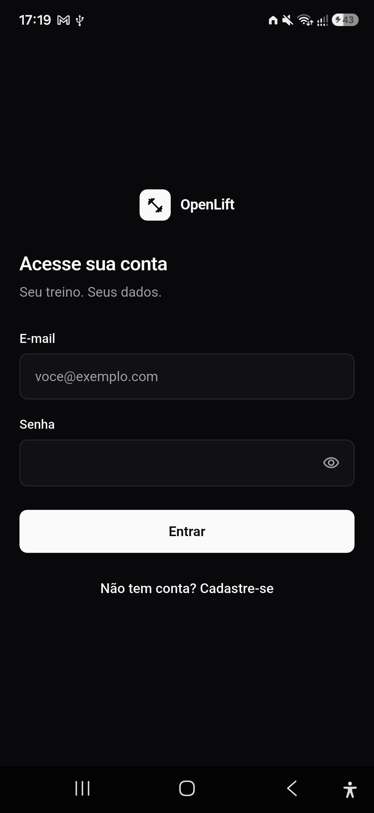
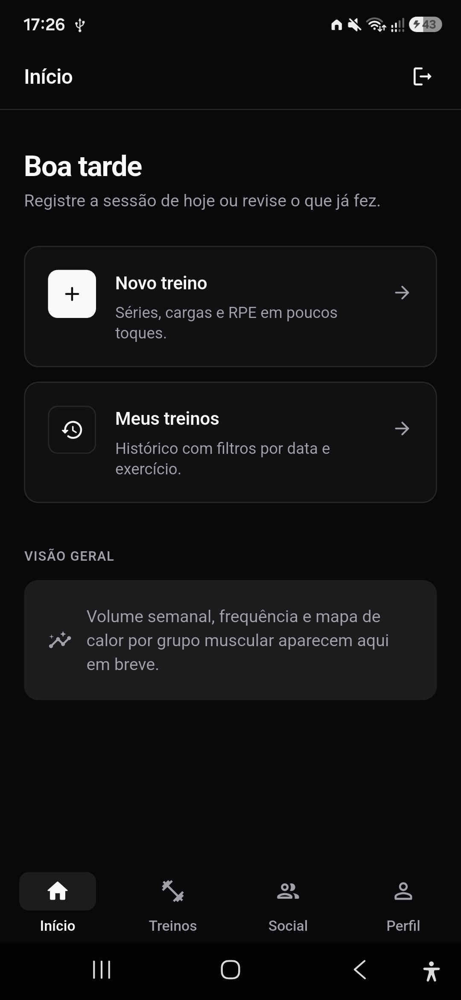
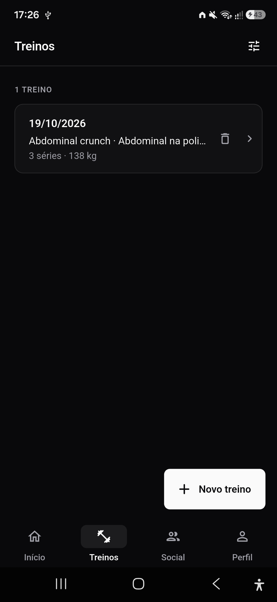
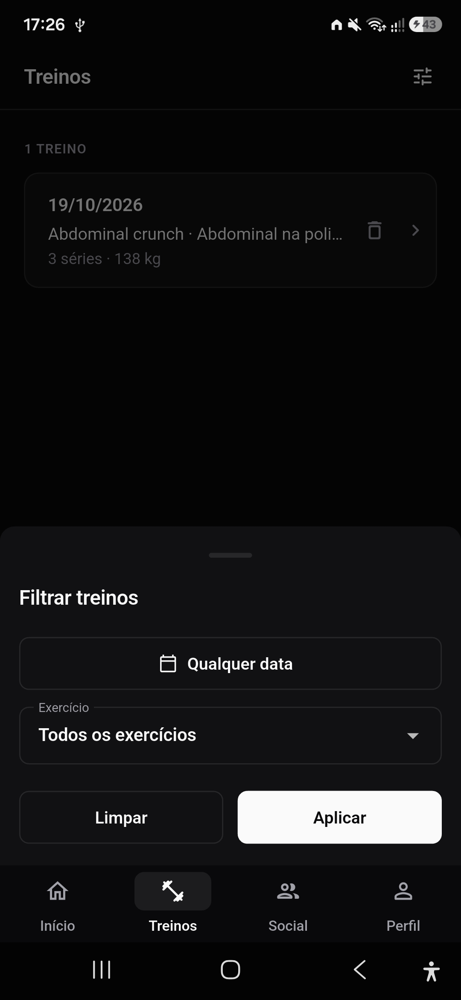
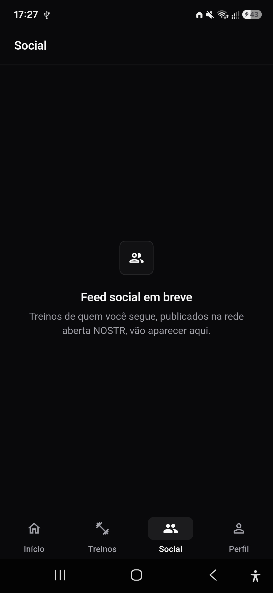
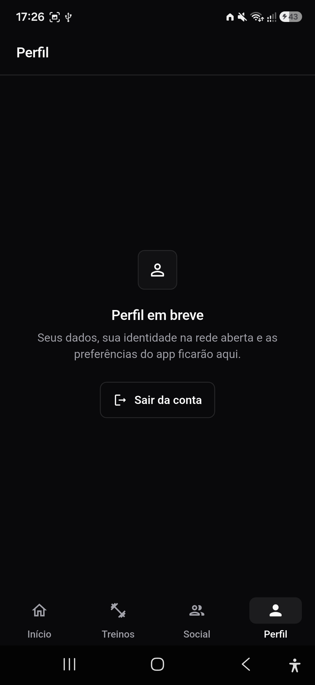

# OpenLift

[](https://github.com/S06-2026-2/Openlift/actions/workflows/backend-ci.yml)
[](https://github.com/S06-2026-2/Openlift/actions/workflows/frontend-ci.yml)
[](https://github.com/S06-2026-2/Openlift/actions/workflows/security.yml)

App de treino de musculação que registra o histórico de exercícios, mostra dashboards e mapa de calor de volume por grupo muscular, e compartilha treinos na rede social aberta [NOSTR](https://nostr.com/) — sem que o usuário precise lidar com chaves criptográficas.

> O histórico é do usuário: publicável e legível por qualquer cliente NOSTR compatível, não propriedade da plataforma.

Projeto acadêmico da disciplina de Produto de Software (turma S06-2026-2). Contexto completo (decisões, requisitos, calendário, riscos): [`docs/CONTEXTO.md`](docs/CONTEXTO.md).

## Telas

<table>
  <tr>
    <td align="center"><br>Login</td>
    <td align="center"><br>Início</td>
    <td align="center"><br>Treinos</td>
  </tr>
  <tr>
    <td align="center"><br>Filtro por data e exercício</td>
    <td align="center"><br>Social</td>
    <td align="center"><br>Perfil</td>
  </tr>
</table>

## Status

Sprint 1 fechada em 19/10. Próxima entrega: Sprint 2 (20/10 → 29/10), identidade NOSTR e treino publicado como evento no relay.

| Funcionalidade | Situação |
|---|---|
| Cadastro e login | ✅ |
| Registro de treino (exercício, séries, carga, repetições, RPE) | ✅ |
| Histórico com filtro por data e exercício | ✅ |
| Evento de treino NOSTR (`kind 1301`, [mini-NIP](docs/nips/openlift-workout-event.md)) | 🟡 núcleo NIP-01 e adapter prontos; publicação no relay na Sprint 2 |
| Feed social com like | ⬜ Sprint 3 |
| Dashboard semanal e mapa de calor por grupo muscular | ⬜ Sprint 4 |

Escopo completo, o que é desejável e o que fica de fora: [`docs/CONTEXTO.md` §6](docs/CONTEXTO.md#6-escopo).

## Stack

- **App:** Flutter (Android e Windows), Riverpod, go_router, Dio, flutter_secure_storage, fl_chart
- **Backend:** Python 3.12, FastAPI, SQLAlchemy 2.0, Alembic, Pydantic v2, PostgreSQL 16
- **Protocolo:** NOSTR — NIP-01 implementado no app (assinatura Schnorr via `bip340`); treino em `kind 1301`
- **Qualidade:** ruff, black, mypy, pytest, flutter analyze, flutter test, gitleaks, commitlint (GitHub Actions)

## Estrutura

```
OpenLift/
├── app/            # App Flutter
├── api/            # Backend FastAPI + PostgreSQL
├── infra/docker/   # docker-compose (Postgres + API + Adminer)
├── docs/           # Contexto, ADRs, requisitos, mini-NIP, QA, runbook
└── .github/        # CI (lint, testes, gitleaks, commitlint) e CD
```

## Como rodar

**Pré-requisitos:** Docker e Flutter. Para Android, o Android SDK (`flutter doctor` mostra o que falta).

### 1. Backend e banco

```bash
cp api/.env.example api/.env    # só necessário para rodar pytest/alembic fora do Docker

cd infra/docker
docker compose up --build -d
docker compose run --rm api alembic upgrade head          # migrations
docker compose run --rm api python -m app.infra.db.seed   # biblioteca de exercícios
```

| Serviço | Endereço |
|---|---|
| API | http://localhost:8000 (rotas em `/docs`) |
| Adminer | http://localhost:8080 (servidor `db`, usuário e senha `openlift`) |

### 2. App

O app chama a API em `http://localhost:8000/api/v1`. Para outro endereço, use `--dart-define=API_URL=...`.

**Android (celular via USB):**

1. No celular, ative as *Opções do desenvolvedor* (Configurações → Sobre o telefone → toque 7× em "Número da versão") e ligue a *Depuração USB*.
2. Conecte o cabo, aceite a permissão no celular e confira com `adb devices`.
3. Faça o `localhost` do celular apontar para o seu PC e rode:

```bash
adb reverse tcp:8000 tcp:8000
cd app
flutter pub get
flutter run
```

Sem cabo (Wi-Fi), aponte direto para o IP do PC: `flutter run --dart-define=API_URL=http://<ip-do-pc>:8000/api/v1`.

**Windows (desktop):**

```bash
cd app
flutter run -d windows
```

> O app ainda não tem suporte a web (não há `app/web/`), então `flutter run -d chrome` não funciona.

## Testes

```bash
# Backend: mesma bateria do CI (de dentro de infra/docker)
docker compose run --rm --no-deps -e ENV=testing -e DATABASE_URL=sqlite:///:memory: api \
  sh -c "ruff check . && black --check . && mypy . && pytest --cov=app"

# App
cd app
flutter analyze
flutter test
```

Rotas, testes de integração e migrations do backend: [`api/README.md`](api/README.md).

## Contribuindo

Regras completas, incluindo a Definition of Done, em [`CLAUDE.md`](CLAUDE.md) e [`AGENTS.md`](AGENTS.md). Valem para humanos e agentes de IA. O essencial:

- **Toda tarefa nasce de uma issue.** Uma issue, uma branch, um PR (`feat/…`, `fix/…`, `docs/…`, `chore/…`).
- Commits em [Conventional Commits](https://www.conventionalcommits.org/) (`feat:`, `fix(api):`, `docs:` …). O CI recusa mensagem fora do padrão.
- Merge em `main` só via PR com **ao menos 1 aprovação**. O PR referencia a issue (`Closes #N`) e declara o uso de IA.
- ADRs em [`docs/adr/`](docs/adr/) não se reabrem sem discussão no grupo.

### Hooks locais

O backend tem hooks de `ruff` e `black` que barram commit mal formatado antes do CI. Instale uma vez por clone, na raiz do repositório:

```bash
pip install pre-commit
pre-commit install --config api/.pre-commit-config.yaml
```

Se um hook corrigir algum arquivo, o commit é interrompido: confira a mudança, faça `git add` e repita o commit.

### Segredos

O CI roda o **gitleaks** em todo PR e fica vermelho se achar chave, token ou senha. Ele protege o RNF-01: a chave privada (`nsec`) nunca entra no repositório. Para rodar antes de abrir o PR: `gitleaks git --config .gitleaks.toml --redact .`

Se ele apontar algo:

1. **Segredo real:** não libere. Considere-o vazado mesmo que o commit seja desfeito: troque-o na origem, remova do código, leia de variável de ambiente (`api/.env`, fora do git) e avise o grupo.
2. **Falso positivo:** use o menor escopo possível — `# gitleaks:allow` no fim da linha, uma regex comentada em `regexes` no [`.gitleaks.toml`](.gitleaks.toml), ou o caminho em `paths` (só para arquivos de exemplo, como `api/.env.example`). Explique a liberação na descrição do PR.
