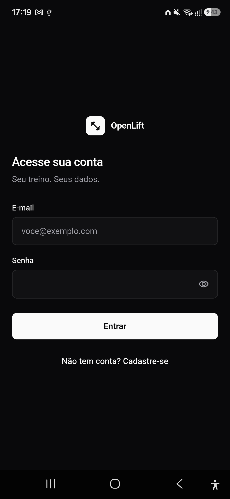
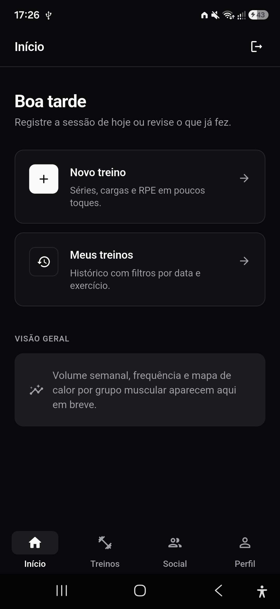
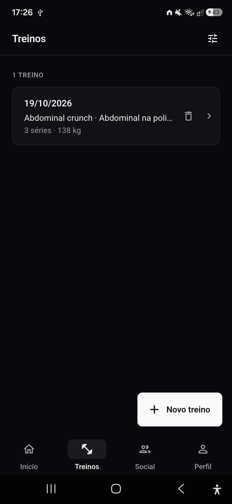
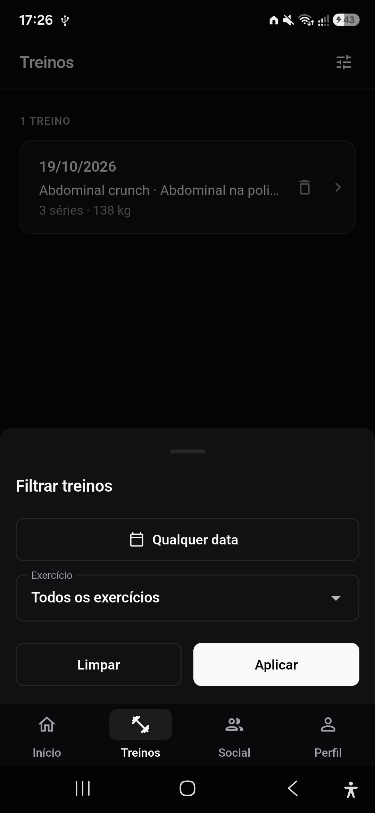
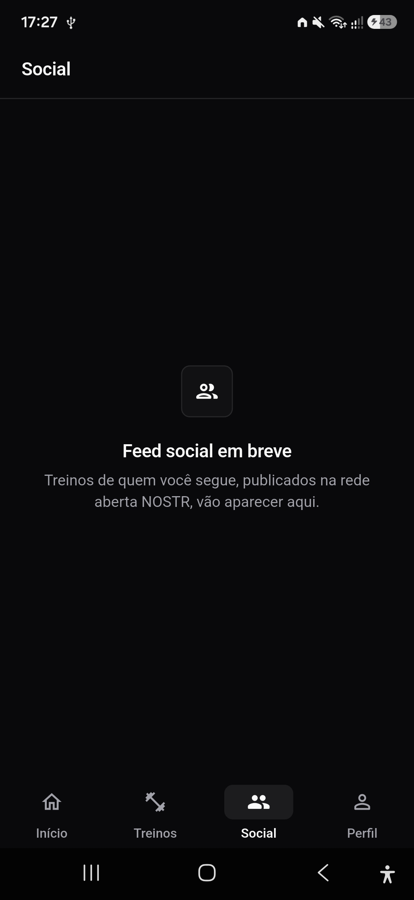
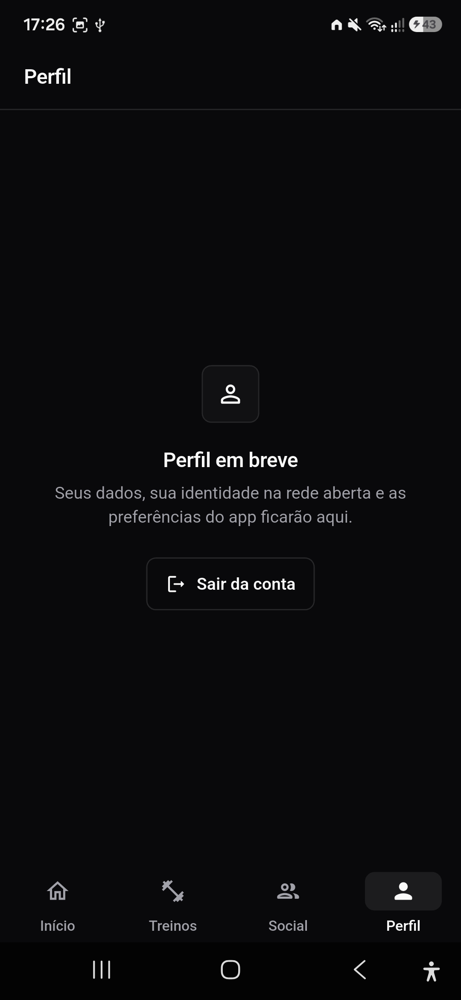

# OpenLift

App de treino de musculação: registre seus treinos, acompanhe a evolução no dashboard e no mapa de calor por grupo muscular, e compartilhe com quem você segue na rede social aberta [NOSTR](https://nostr.com/), sem precisar lidar com chaves criptográficas.

> O histórico é seu: publicável e legível por qualquer cliente NOSTR compatível, não propriedade da plataforma.

## Como usar

### No navegador

Acesse **<https://openlift-web-production.up.railway.app>**, crie sua conta e pronto. Funciona no computador e no navegador do celular.

### No Android (APK)

1. Baixe o arquivo `openlift-<versão>.apk` da [**última versão**](https://github.com/S06-2026-2/Openlift/releases/latest).
2. Abra o arquivo no celular. Se o Android pedir, permita instalar apps desta fonte (navegador ou gerenciador de arquivos).
3. Abra o OpenLift e entre com sua conta (a mesma da versão web serve).

Para atualizar, baixe e instale o APK da versão mais nova por cima do atual.

> **Conta x identidade na rede social.** Treinos e dados da conta ficam no servidor e aparecem em qualquer aparelho. Já a identidade NOSTR (quem publica no feed) fica guardada no aparelho: entrar em outro aparelho ou navegador cria uma identidade nova, a não ser que você importe a sua `nsec` em **Perfil → Configurações avançadas** ([ADR-0005](docs/adr/0005-identidade-nostr.md)).

## O que dá para fazer

- Registrar treinos com exercício, séries, carga, repetições e RPE
- Ver o histórico, com filtro por data e exercício
- Acompanhar volume semanal, frequência e mapa de calor por grupo muscular
- Seguir pessoas, ver o feed, curtir, postar fotos e comentar
- Levar seus treinos para outro app NOSTR: eles são publicados como eventos abertos (`kind 1301`)

<table>
  <tr>
    <td align="center"> Login</td>
    <td align="center"> Início</td>
    <td align="center"> Treinos</td>
  </tr>
  <tr>
    <td align="center"> Filtro por data e exercício</td>
    <td align="center"> Social</td>
    <td align="center"> Perfil</td>
  </tr>
</table>

## Para quem desenvolve

Projeto acadêmico da disciplina de Produto de Software (turma S06-2026-2). Flutter no app; FastAPI e PostgreSQL na API.

| Documento | Conteúdo |
|---|---|
| [`docs/runbook/subir-ambiente.md`](docs/runbook/subir-ambiente.md) | Rodar API, banco e app na sua máquina (web, Android e Windows) |
| [`CONTRIBUTING.md`](CONTRIBUTING.md) | Issues, branches, PRs, testes, hooks e segredos |
| [`docs/CONTEXTO.md`](docs/CONTEXTO.md) | Decisões (ADRs), requisitos, calendário e status das sprints |
| [`api/README.md`](api/README.md) | Rotas, testes e variáveis do backend |
| [`docs/nips/openlift-workout-event.md`](docs/nips/openlift-workout-event.md) | Formato do evento de treino NOSTR |
