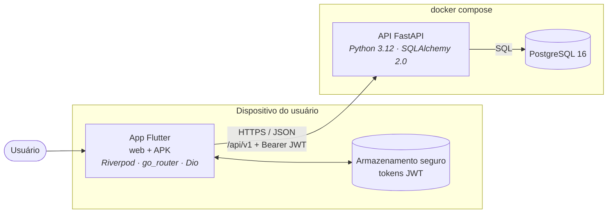
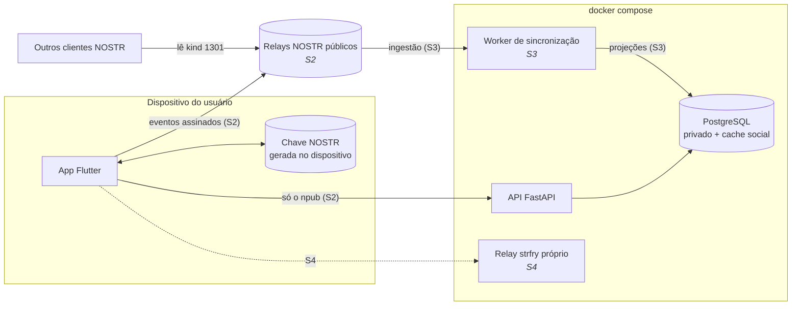
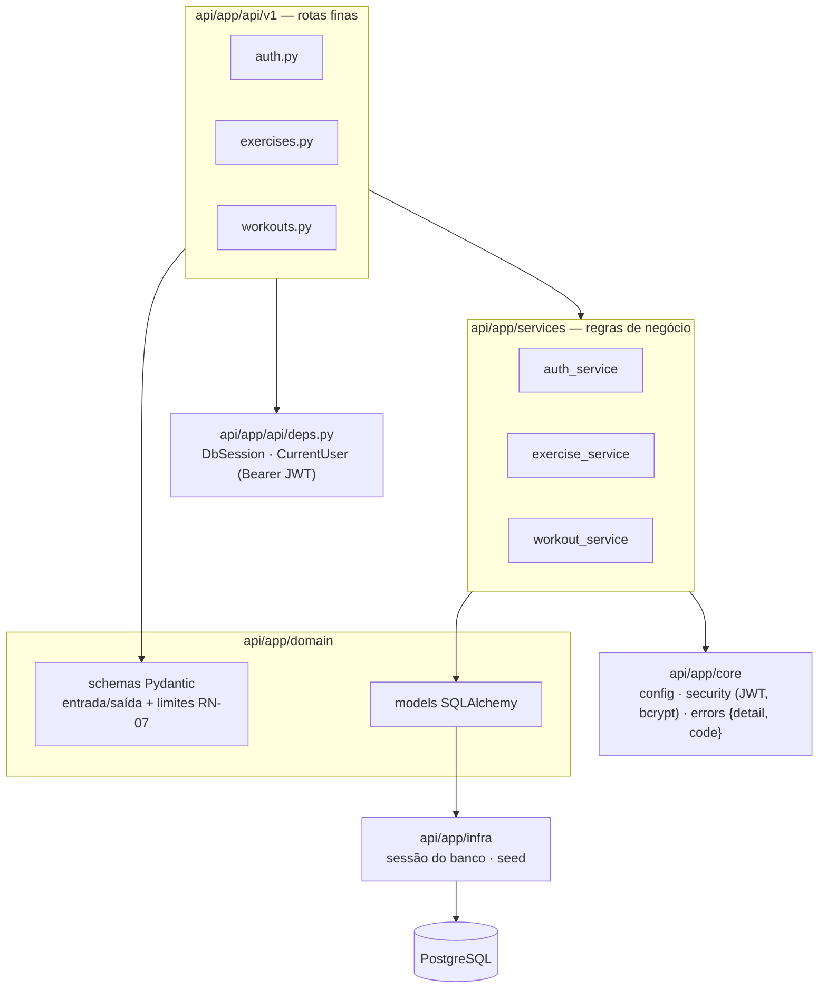
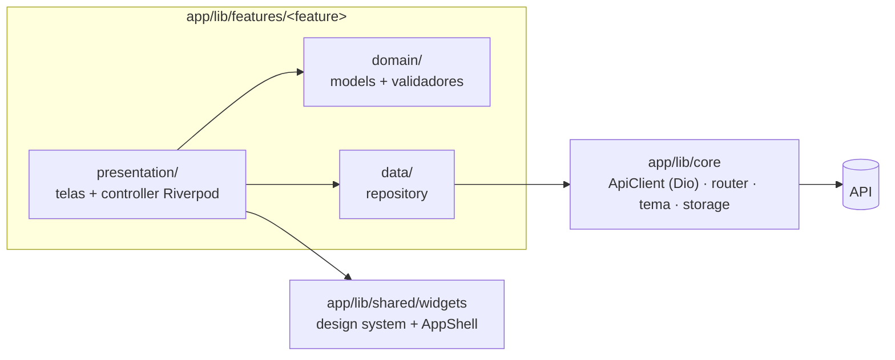
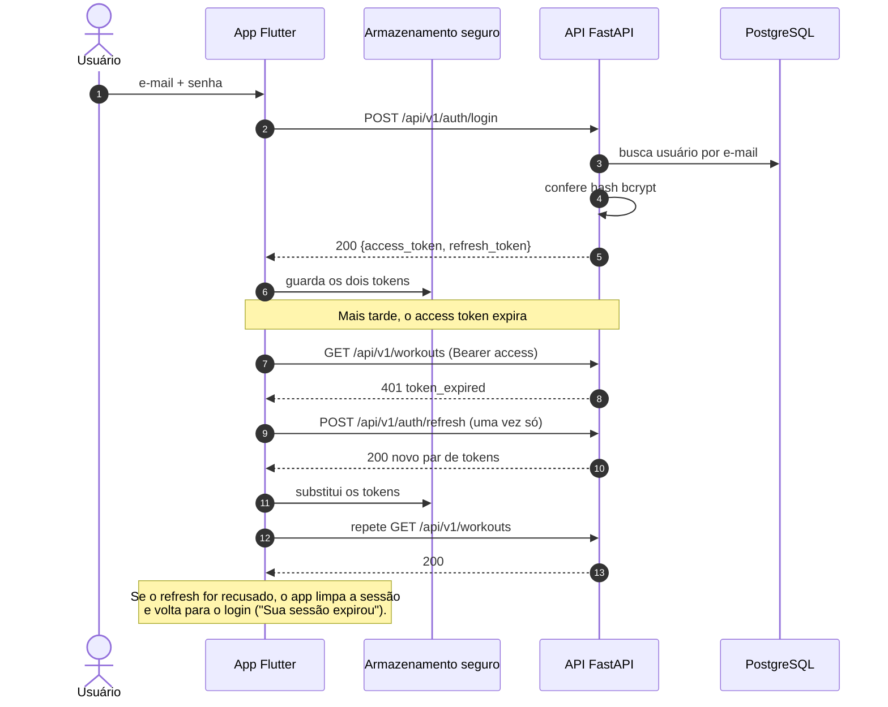
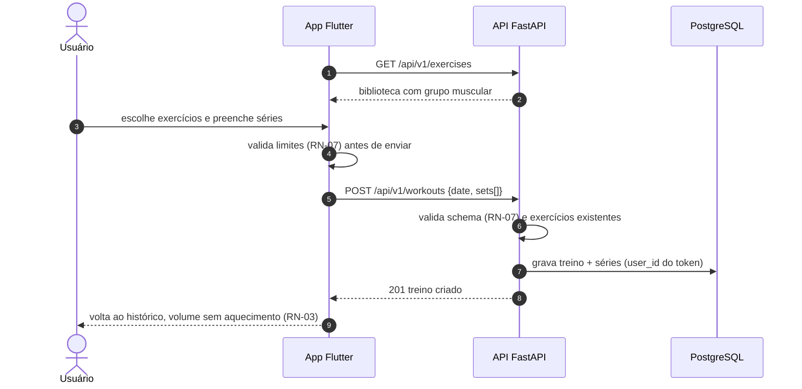
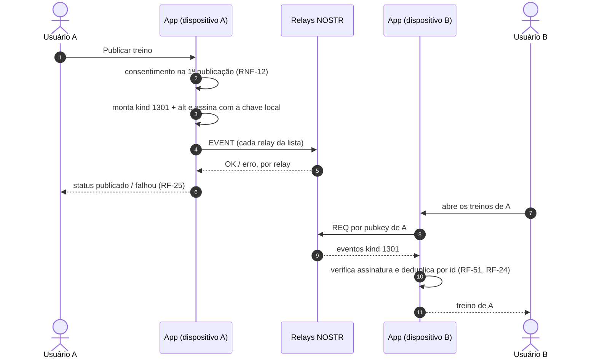

# Arquitetura

Visão de como o OpenLift é montado: contêineres, camadas e os fluxos principais. Os diagramas são [Mermaid](https://mermaid.js.org/) e o GitHub os desenha direto no navegador.

**Atualizado em 17/10/2026**, fim da Sprint 1. Cada diagrama diz se mostra o que **existe** ou o que está **planejado**. Mudou a arquitetura? Atualize o diagrama no mesmo PR.

As decisões por trás deste desenho estão em [`docs/adr/`](../adr/): principalmente [ADR-0001](../adr/0001-frontend-flutter-web-e-apk.md) (Flutter), [ADR-0002](../adr/0002-backend-python-fastapi-postgresql.md) (FastAPI + Postgres), [ADR-0004](../adr/0004-onde-o-dado-vive.md) (onde o dado vive) e [ADR-0007](../adr/0007-relays.md) (relays).

---

## 1. Contêineres

### Hoje (fim da Sprint 1)

### Planejado (Sprints 2 a 4)

| Contêiner | Responsabilidade | Onde está |
|---|---|---|
| App Flutter | Telas, validação de formulário, sessão, e (a partir da S2) geração da chave e assinatura de eventos **no dispositivo** | `app/` |
| API FastAPI | Conta, treino privado (séries, carga, RPE), histórico e agregações | `api/` |
| PostgreSQL | Dado privado e **cache** das agregações sociais, reconstruível por replay (ADR-0004) | `infra/docker/docker-compose.yml` |
| Relays NOSTR | Dado social e portátil: treinos publicados, likes, follows | Públicos até a Demo 3 (ADR-0007) |
| Worker | Ingestão dos eventos, verificação de assinatura e projeção no Postgres | Planejado (S3) |
| strfry | Relay próprio, para não depender de rede alheia na Demo 4 | Planejado (S4) |
| Adminer | Interface web para inspecionar o banco, **só em desenvolvimento** (`localhost:8080`) | `infra/docker/docker-compose.yml` |

**Fronteira de segurança:** a chave privada NOSTR fica no dispositivo e **nunca** atravessa a seta para a API (RNF-01, ADR-0006). A API só conhece o `npub`.

---

## 2. Camadas do backend (existe)

- **Rota** valida a entrada (schema), chama o service e devolve o schema de saída. Não tem regra de negócio.
- **Service** concentra a regra e o **isolamento por usuário**: toda consulta filtra por `current_user.id`, e recurso de outra pessoa responde 404.
- **Erros** sempre como `ApiError` → `{"detail": "...", "code": "..."}`; 422 traz também `errors` com o campo.

## 3. Camadas do frontend (existe)

Features hoje: `auth`, `workouts` (prontas), `dashboard` e `social` (estrutura com TODOs para as Sprints 3–5).

---

## 4. Sequência: login e renovação de sessão (existe)

Várias requisições com 401 ao mesmo tempo compartilham um único refresh, e falha de **rede** no refresh não derruba a sessão (`app/lib/core/network/api_client.dart`).

## 5. Sequência: registrar treino (existe)

## 6. Sequência: publicar treino e ler em outro dispositivo (planejado — Sprint 2)

> **Planejado.** O formato das tags do evento depende do mini-NIP (NOSTR-01, #22), e o modo como o backend fica sabendo da publicação será definido nas histórias S2-04/S2-05 ([`docs/qa/sprint-2.md`](../qa/sprint-2.md)). O diagrama mostra só o que já está decidido nos ADRs.

